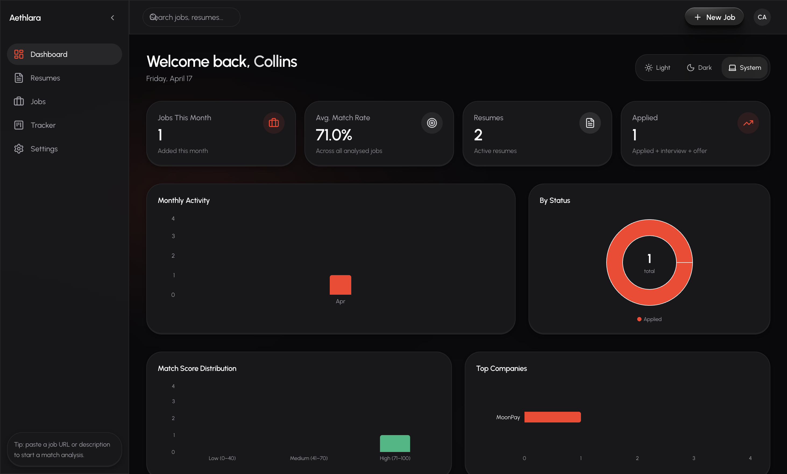
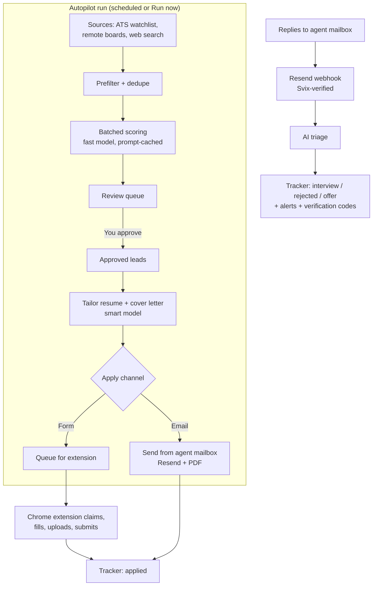

<div align="center">



# Aethlara

**An open-source AI job-hunting agent: it finds roles that fit you, applies to the ones you approve, and tracks every reply.**

[](./LICENSE)
[](https://golang.org)
[](https://nodejs.org)
[](https://github.com/collinsadi/aethlara)
[](./CONTRIBUTING.md)

</div>

---

## Table of Contents

- [Overview](#overview)
- [Features](#features)
- [Tech Stack](#tech-stack)
- [Project Structure](#project-structure)
- [Getting Started](#getting-started)
  - [Prerequisites](#prerequisites)
  - [Clone the repository](#clone-the-repository)
  - [Backend setup (with Docker)](#backend-setup-with-docker--recommended)
  - [Backend setup (without Docker)](#backend-setup-without-docker)
  - [Frontend setup](#frontend-setup)
  - [Environment variables](#environment-variables)
- [Chrome Extension](#chrome-extension)
  - [What it does](#what-it-does)
  - [Download and install](#download-and-install)
  - [Build from source](#build-from-source)
- [API Documentation](#api-documentation)
- [How It Works](#how-it-works)
- [Autopilot Setup](#autopilot-setup)
- [Open Source & Self-Hosting](#open-source--self-hosting)
- [Contributing](#contributing)
- [License](#license)
- [Author](#author)

---

## Overview

Aethlara is an open-source job-hunting agent. Upload your resume and tell it what you are looking for; from then on it works on a schedule:

1. **It searches.** Company boards on Greenhouse, Lever and Ashby from your watchlist, the big remote boards (Remotive, Remote OK, Himalayas, Jobicy, Arbeitnow), and — with an Anthropic key — Claude web search.
2. **It scores.** Every posting is matched against your resume and preferences, with a one-line reason, strengths and gaps. Deal-breakers (location, authorization, seniority, salary) are filtered out before you ever see them.
3. **You approve.** Triage the queue in seconds (keyboard shortcuts, bulk actions). Approval is the only manual step.
4. **It applies on the next run.** Each approved job gets a tailored resume and cover letter. Email applications are sent from your agent's own mailbox; form applications (Greenhouse, Lever, Ashby and more) are filled and submitted by the Chrome extension in your browser.
5. **It follows up.** Replies land in the agent's mailbox, get triaged by AI, and move your tracker automatically — confirmations, rejections, interview invites, assessments and offers. Verification codes are picked up and entered for you. Anything that needs you (an unusual question, a CAPTCHA) is asked once and remembered.

**The approach.** Aethlara is fully open source under MIT and runs on your own AI key — Anthropic (recommended; enables web search) or OpenRouter — encrypted with AES-256-GCM. No subscriptions, no lock-in, no training on your data. Self-hosting is a `docker compose up` away.

---

## Features

- **Autopilot** — scheduled runs (every 1–168 hours) or "Run now": apply to what you approved, discover new jobs, email you a digest
- **Job discovery** — Greenhouse / Lever / Ashby company watchlist (starter list included), Remotive, Remote OK, Himalayas, Jobicy, Arbeitnow and Claude web search; responses cached and shared across users
- **AI match scoring** — batched, prompt-cached scoring on your fast model with fit, reasons, gaps and deal-breakers; low scores auto-dismissed, optional auto-approve threshold
- **Review queue** — keyboard-first triage (J/K/A/X/O), bulk approve, filters, undo, "add a job by URL"
- **Hands-free applying** — tailored resume + cover letter per job; email applications sent from the agent's address with the PDF attached; form applications queued for the Chrome extension with a lease-based claim protocol
- **Agent mailbox** — every user gets `name@your-agent-domain` (Resend Inbound); applications use it so replies come back to the agent; Svix-signed webhook, idempotent ingestion, SPF/DKIM/DMARC-aware
- **Inbox triage** — AI classifies mail (confirmation, rejection, interview, assessment, offer, verification, recruiter) and advances the tracker; important mail alerts; verification codes exposed to the extension
- **Learned answers** — questions the agent cannot answer are asked once and reused on every later form
- **Anthropic + OpenRouter** — bring either key; smart/fast model slots per user; official Anthropic Go SDK with structured outputs, prompt caching, adaptive thinking and server-side refusal fallbacks
- **Resume upload + AI extraction** — PDF, DOCX or Markdown to structured JSON
- **Tailored PDF resumes + match scoring** — per job, stored on Cloudflare R2
- **Kanban tracker + analytics** — updated automatically by the agent
- **Per-job AI chat** — strategy, interview prep, cover letter drafting
- **Chrome extension** — long-lived revocable device auth, autopilot runner, side panel, ATS-aware form filling with resume upload
- **Passwordless OTP auth**, encrypted API keys, light and dark mode

---

## Tech Stack

| Frontend | Backend |
|---|---|
| React 19 + TypeScript | Go 1.22+ |
| Vite | Chi Router |
| Tailwind CSS v4 | PostgreSQL (via pgx) |
| React Query v5 | Cloudflare R2 (S3-compatible) |
| React Hook Form + Zod | Anthropic Go SDK + OpenRouter (per-user keys) |
| dnd-kit | Resend (transactional + inbound email) |
| Recharts | AES-256-GCM encryption |
| React Router v7 | golang-jwt (access + refresh tokens) |
| Axios + js-cookie | Docker + Docker Compose |
| Framer Motion | Air (hot reload) |
| Zustand | `crypto/rand` for OTPs and refresh tokens |

---

## Project Structure

```
aethlara/
├── client/                   # React + TypeScript frontend (Vite)
│   ├── src/                  # Application source (api, components, hooks, pages, lib, stores)
│   ├── public/               # Static assets
│   ├── dist/                 # Production build output
│   ├── index.html
│   ├── vite.config.ts
│   ├── tsconfig.json
│   └── package.json
│
├── server/                   # Go REST API backend
│   ├── cmd/api/              # Application entrypoint
│   ├── internal/             # Domain modules (agent + agent/sources, auth, user, resume, job, chat, settings, analytics, ai, prompts, apikey, email, storage, middleware, database, config)
│   ├── pkg/                  # Shared utilities (response, validator, tokenutil)
│   ├── Dockerfile
│   ├── docker-compose.yml
│   ├── .air.toml             # Hot reload config
│   └── docs.md               # Full API documentation
│
├── extension/                # Chrome extension (Manifest v3, React + Vite)
│   ├── src/
│   │   ├── background/       # Service worker (device auth, API client, autopilot runner, tabs)
│   │   ├── content/          # Content script (form detection and filling, ATS adapters, submit flow)
│   │   ├── sidepanel/        # React side panel (Autopilot, Review, This page, Settings)
│   │   ├── types/            # API, runner and message contracts
│   │   └── lib/              # Shared utilities (config, storage, messaging, queryClient)
│   ├── manifest.json         # Manifest v3 declaration
│   ├── package.json
│   └── vite.config.ts
│
├── dashboard.png             # Dashboard preview
├── README.md
├── CONTRIBUTING.md
└── LICENSE
```

---

## Getting Started

### Prerequisites

- **Go** 1.25 or newer
- **Node.js** 18 or newer
- **PostgreSQL** 15 or newer (or Docker)
- A **Cloudflare R2** bucket with an access key pair
- A **Resend** account and API key for transactional email (and, for the agent mailbox, Resend Inbound on a domain you own)
- An **Anthropic** or **OpenRouter** API key — each user adds their own in Settings; the server holds no AI key

### Clone the repository

```bash
git clone https://github.com/collinsadi/aethlara.git
cd aethlara
```

### Backend setup (with Docker — recommended)

```bash
cd server
cp .env.example .env
# Fill in your .env values (see "Environment variables" below)
docker compose up --build
```

The API will be available at `http://localhost:8080`.

### Backend setup (without Docker)

```bash
cd server
cp .env.example .env
# Fill in your .env values
go mod download
air   # or: go run cmd/api/main.go
```

### Frontend setup

```bash
cd client
cp .env.example .env   # if missing, create it with the line below
# VITE_API_URL=http://localhost:8080/api/v1
npm install
npm run dev
```

The client will be available at `http://localhost:5173`.

### Environment variables

The full variable reference lives in [`server/.env.example`](./server/.env.example) and `client/.env`. The most critical server variables:

| Variable | Purpose |
|---|---|
| `DATABASE_URL` | PostgreSQL connection string |
| `JWT_ACCESS_SECRET` / `JWT_REFRESH_SECRET` | JWT signing secrets (min 32 chars each) |
| `R2_ACCOUNT_ID` / `R2_ACCESS_KEY_ID` / `R2_SECRET_ACCESS_KEY` / `R2_BUCKET_NAME` / `R2_PUBLIC_ENDPOINT` | Cloudflare R2 credentials |
| `RESEND_API_KEY` | Resend API key for OTP, notification and agent email |
| `AGENT_RESEND_API_KEY` | Optional key for the Resend account that owns `AGENT_MAIL_DOMAIN`, if that differs from `RESEND_API_KEY`'s. Must be **full access**: the agent sends applications and reads received mail |
| `API_KEY_ENCRYPTION_SECRET` | AES-256-GCM key for user-supplied Anthropic/OpenRouter keys |
| `ANTHROPIC_MODEL` / `ANTHROPIC_FAST_MODEL` | Default smart/fast models for Anthropic users (`claude-opus-5-5` / `claude-haiku-5-5`) |
| `OPENROUTER_MODEL` / `OPENROUTER_FAST_MODEL` | Default smart/fast models for OpenRouter users |
| `AGENT_MAIL_DOMAIN` | Subdomain whose MX points at Resend Inbound, e.g. `agent.example.com` (empty disables agent mailboxes) |
| `RESEND_WEBHOOK_SECRET` | Signing secret of the Resend `email.received` webhook |
| `AGENT_SCHEDULER_*`, `AGENT_MAX_*` | Scheduler tick, concurrency, run timeout and per-run scoring cap |

> **Important.** `API_KEY_ENCRYPTION_SECRET` must be exactly **32 bytes** (64 hex chars). Generate one with:
>
> ```bash
> openssl rand -hex 32
> ```
>
> Changing this value after users have saved API keys will render those stored keys unrecoverable.

---

## Chrome Extension

The `extension/` folder contains the Aethlara Chrome extension (Manifest V3, v2). It is the autopilot's hands: the server finds and scores jobs, you approve the ones worth applying to, and the extension fills and submits those applications **in your own browser**, then reports the outcome back to Aethlara.

### What it does

- **Applies for the autopilot** — While *Apply automatically* is on, it checks the queue on a schedule (or right away with *Apply now*), opens each approved application in a background tab, fills it with the answers the server prepared, attaches your tailored resume and cover letter, and submits. Greenhouse, Lever and Ashby have dedicated adapters; a generic adapter handles other forms.
- **Stops when it should** — CAPTCHAs, sign-in walls, questions only you can answer and unexpected redirects pause the application with a notification. Answer in the dashboard and it carries on; emailed security codes are read from the agent mailbox automatically.
- **Side panel** — *Autopilot* (status, queue, live progress), *Review* (approve or dismiss new leads) and *This page* (send the posting to the agent, fill the open form, or extract the job into your tracker).
- **Stays connected** — A one-time, 60-second handshake from the dashboard gives the extension a rotating device token, so it stays signed in across browser restarts. Disconnect it any time from **Settings → Extension**.
- **Scoped access** — Host permission for the Aethlara API only. The content script runs on every page so it can fill forms on any job site, but it never calls the API and never sees tokens.

### Download and install

The packaged extension lives at [`client/public/downloadable/aethlara-extension-v2.zip`](./client/public/downloadable/aethlara-extension-v2.zip) and is also available in-app:

1. Open the Aethlara dashboard or landing page and click **Download Extension** (or visit `/extension`).
2. Unzip the file — you should see a folder containing `manifest.json`, `sidepanel.html`, `assets/`, `background/`, `content/` and `icons/`.
3. Open your browser's extensions page (`chrome://extensions`, `brave://extensions`, `edge://extensions`, or `arc://extensions`).
4. Enable **Developer mode** (top-right toggle).
5. Click **Load unpacked** and select the unzipped folder (the one that directly contains `manifest.json`).
6. Pin the Aethlara icon to your toolbar via the puzzle-piece menu; clicking it opens the side panel.
7. Click **Open dashboard to connect** in the side panel, then **Connect Chrome extension** in **Settings → Extension**.

Upgrading from v1? Remove the old extension first so you don't end up with two copies. Chrome 116 or newer is required.

A step-by-step guide is also available in-app at `/extension/install`.

### Build from source

If you'd rather build the extension yourself (recommended for self-hosted deployments so you can point it at your own API):

```bash
cd extension
cp .env.example .env
# Edit .env:
#   VITE_API_BASE_URL=https://your-api-domain.com/api/v1   (its origin becomes the host permission)
#   VITE_DASHBOARD_URL=https://your-dashboard-domain.com
npm install
npm run build
```

The build output lives in `extension/dist/`. Load that folder as an unpacked extension via the steps above.

> **Note.** The bundled `aethlara-extension-v2.zip` is built against the hosted Aethlara API. Self-hosters should rebuild from source so the extension talks to their own server.

For the full extension reference (permissions, limitations, internal architecture), see [`extension/README.md`](./extension/README.md).

---

## API Documentation

Full endpoint documentation lives in [`server/docs.md`](./server/docs.md).

**Base URL:** `/api/v1`

Module groups:

- [Auth](./server/docs.md#authentication) — signup, verify-otp, login, refresh, logout, logout-all
- [User](./server/docs.md#7-get-userme) — profile (`/user/me`)
- Resumes — upload, list, preview URL, soft delete
- Jobs — create (URL or text), list, detail, status transitions, preview, delete
- Settings — AI provider + per-provider API keys, profile update, email change flow
- [Autopilot](./server/docs.md#autopilot-agent) — profile, runs, events, leads, applications, extension protocol, agent inbox, saved answers, Resend webhook
- [Extension devices](./server/docs.md#extension-devices) — handshake exchange, rotating device tokens
- Analytics — dashboard aggregations

All responses follow a consistent envelope:

```json
{ "data": { "...": "..." }, "message": "optional string" }
```

```json
{ "error": { "code": "ERROR_CODE", "message": "Human-readable message." } }
```

---

## How It Works



Every AI call goes through `server/internal/ai`, which resolves the user's own encrypted key per request and dispatches to Anthropic (official Go SDK) or OpenRouter. Prompts are versioned in `server/internal/prompts/`. The full API is documented in [`server/docs.md`](./server/docs.md).

---

## Autopilot Setup

1. **AI key** — in Settings → AI provider, add an Anthropic key (recommended; enables Claude web search) or an OpenRouter key. Pick smart/fast models or keep the defaults.
2. **Resume** — upload one; the agent seeds your search preferences and application profile from it.
3. **Preferences** — in Autopilot → Settings, set target titles, keywords, locations/remote, seniority, salary floor, exclusions, sources and your company watchlist, plus the answers forms always ask (work authorization, sponsorship, notice period, links, voluntary self-identification).
4. **Agent mailbox** (self-hosters) — set `AGENT_MAIL_DOMAIN` to a subdomain, add it to Resend for receiving (MX) and sending (SPF/DKIM), and point a Resend `email.received` webhook at `https://<api>/api/v1/webhooks/resend` with its secret in `RESEND_WEBHOOK_SECRET`. Use a subdomain: Resend receives all mail for the domain.
5. **Extension** — install it, connect once from Settings → Extension, and turn on its autopilot. It works the queue while Chrome is open.
6. **Turn on Autopilot** — the first run starts right away; after that it runs on your schedule. Review the queue whenever it emails you.

---

## Open Source & Self-Hosting

Aethlara is fully open source under the [MIT License](./LICENSE).

- **Hosted version** — bring your own Anthropic or OpenRouter API key; no subscription, no usage caps beyond what your provider charges you.
- **Self-hosted** — `docker compose up --build` in `server/`, `npm run dev` in `client/`, point the client at your server. That's it.
- **Contributions** — pull requests, issues, and discussions are all welcome. See [`CONTRIBUTING.md`](./CONTRIBUTING.md).

---

## Contributing

Aethlara is built in the open. Bug reports, feature ideas, and pull requests are genuinely welcome — please read [`CONTRIBUTING.md`](./CONTRIBUTING.md) for the commit convention, PR guidelines, and project structure guide before you start.

---

## License

Released under the [MIT License](./LICENSE).

Copyright © 2026 Collins Adi.

---

## Author

**Collins Adi** — [@collinsadi](https://github.com/collinsadi)
